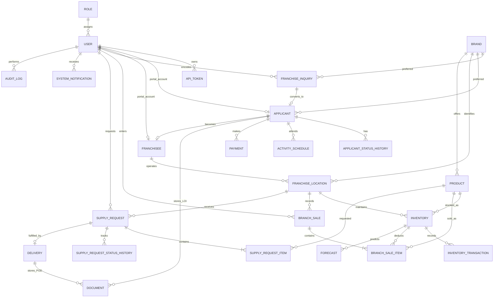

# Entity Relationship Overview

## Design notes

- Role names are fixed application enums but stored in a normalized `roles` table.
- Applicant and franchisee portal accounts are optional one-to-one links to `users`.
- Warehouses and branches share `franchise_locations`; only franchise locations require a franchisee.
- Inventory is unique by `(location_id, product_id)`.
- Branch portals are mapped by the unique nullable `franchise_locations.branch_code`.
- Branch sales use a per-location client reference for idempotency and save item-level before/after balances.
- Supply requests keep immutable status-history records and a single delivery record.
- Documents use a polymorphic relation so LOIs belong to applicants and PODs belong to deliveries.
- Forecasts preserve their input series and method metadata for auditability.
